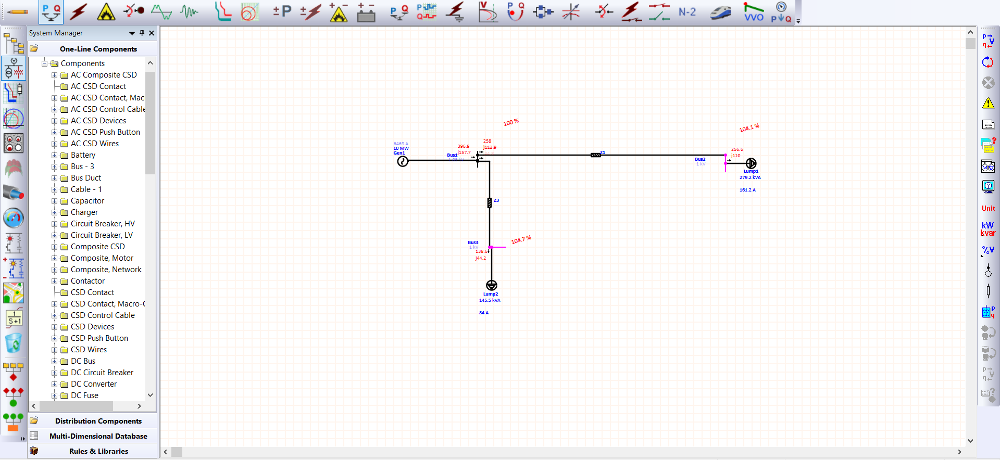

# ETAP Load Flow Analysis 

This project demonstrates electrical power system modeling and load flow analysis using ETAP.

## Objectives

* Model the electrical power network.
* Perform load flow analysis using Newton Raphson Method.

## Project Contents

* ETAP Project/ - Original project files.
* Results/ - Exported reports and calculations.
* Screenshots/ - Network diagrams and simulation results.

## Software 

* ETAP 19

--

