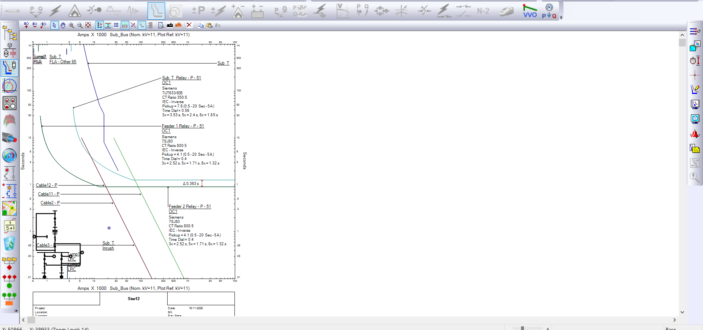
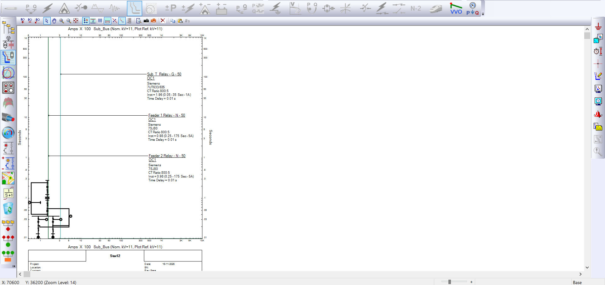

# 66/11 kV Substation Protection & Coordination Scheme

In this project, Idesigned and tested comprehensive protection scheme using Siemens relays, focusing on two main challenges: Differential Protection and Overcurrent Coordination.

## Project Contents

    - Results/ - Exported reports and calculations.
    - Screenshots/ - Network diagrams and simulation results.

## Software 

* ETAP 19

<video controls src='./Screenshots/overcurrentcoordination.mp4'></video>

## Experimental Setup:

 * Transformer & Busbar Protection:
Implemented Differential Protection (87T/87B) using the Siemens 7UT633/635 relay.
 * Feeder & Backup Protection: 
Used the Siemens 7SJ80 relays for Feeder Overcurrent (50N/51P).
 * Overcurrent Coordination:
Feeders (Load1/Load2) coordinated with transformer overcurrent element.

 * Ground/Neutral Coordination (50G/50N):
Coordinate the Transformer Ground Instantaneous (50G) element and Feeder Neutral Instantaneous (50G) elements.

