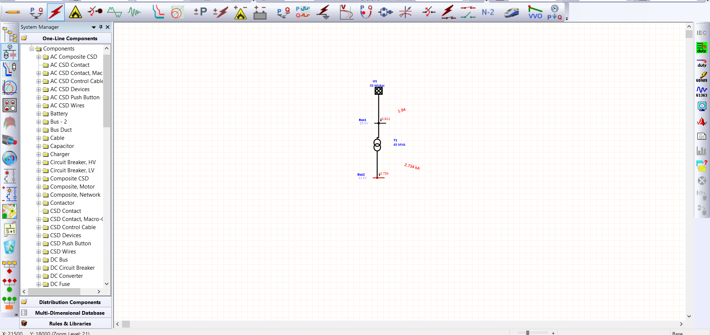
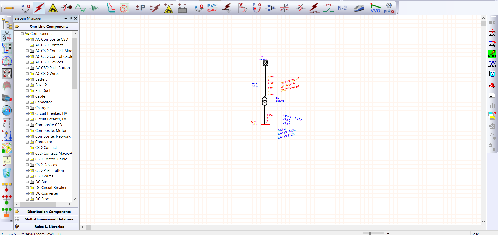

# ETAP Short Circuit Analysis

This project demonstrates electrical power system modeling and short-circuit analysis using ETAP.

## Objectives

* Model the electrical power network.
* Perform short-circuit calculations.
* Compare simulation results with hand calculations.

## Project Contents

* Screenshots/ - Network diagrams and simulation results.
* Results/ - Exported reports and calculations.
* ETAP Project/ - Original project files.

## Software  

* ETAP 19.

## Three Phase Fault Results

* Falow this link whare I hand calculate this results using MVA Method.
<a href="https://abdalsamieali.github.io/posts/no12.html">MVA Method</a>

* Falow this link whare I hand calculate this results using per unit and symmatrical components.
<a href="https://abdalsamieali.github.io/posts/no14.html">Single Line to Ground Fault</a>

